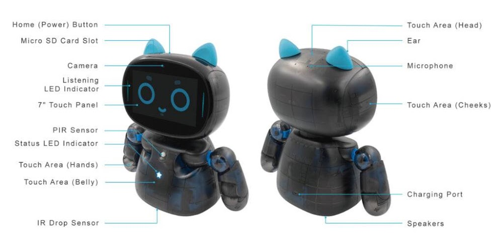

# 골든타임 응급대응 소셜 로봇 연구제안서
연구 책임자: 오염덕 & 연구원: 유익
## 1. 연구의 요약 및 핵심 주장(Executive Summary)
본 연구 과제의 핵심 가치는 의학적 "진단(Diagonosis)"이 아니라, 급성 응급 발생 시 발견-신고-초동 지시까지 발생하는 3대 치명적 지연 시간, 즉 '인식 지연(Time-to-Recognition)', '출동 지연(Time-to-Dispatch)', '초동 압박 지연(Time-to-First-Compression)'을 최소화하는 것에 있다. 이 세 구간은 심정지 및 뇌졸중 환자의 생존율을 결정짓는 골든타임 손실의 대부분을 차지하며, 물리적·의학적 처치를 직접 수행할 수 없는 '비접촉 데스크톱 소셜 로봇'이 개입하여 사회적 기여를 할 수 있는 유일하고도 가장 효과적인 오퍼레이션 구간이다.

본 연구는 로봇의 역할을 고비용의 전문 진단 기기가 아닌, **"현장 밀착형 트리아지(Triage) 보조 및 119 디스패처 연장 단말(Dispatcher-Assisted CPR On-Scene Terminal)"**로 명확히 포징한다. 이러한 접근법은 기술적 실현 가능성을 극대화할 뿐만 아니라, 의료기기 인허가 장벽을 영리하게 우회하는 전략적 기반이 된다.
## 2. 대상 사건 및 시스템 사양 (Target Events & System Specifications)
2.1 대상 사건 (Target Emergency Events)
- 급성 허탈 (Acute Collapse): 심정지가 의심되는 급작스러운 쓰러짐 및 움직임 소실.
뇌졸중 의심 징후 (Acute Stroke Indicators): 안면 및 편측 마비(Hemiplegia), 구음장애(Dysarthria), 비대칭적 낙상 패턴.
의식 소실을 동반한 중증 낙상 (Traumatic Fall with Loss of Consciousness).

2.2 하드웨어 플랫폼 전제 및 사양 (Platform Constraints)
본 연구는 고전력·고비용의 맞춤형 로봇을 배제하고, 코딩 교육용 로봇(누아로보틱스 케비로봇)의 사양을 basekube으로 전제한다.

- 센서 풋프린트: RGB 비전 카메라, 마이크 어레이(Microphone Array), PIR(인체감지) 센서, IR(적외선) 낙하 감지 센서, 정전식 터치 센서.
- 액추에이터 및 I/O: 7인치 터치 디스플레이, 다축 상지 관절 모듈(Expressive Upper Limbs), 듀얼 스피커, 상태 표시형 LED 인디케이터.
- 기능적 경계: 환자에 대한 직접적인 물리적 처치(Mechanical Intervention) 기능은 포함하지 않음.
## 3. 핵심 기술 기여 (Core TeTechnical Contributions)
계층형 캐스케이드 추론 구조 (Hierarchical Cascade Inference)
컴퓨팅 자원이 제한된 엣지(Edge) 환경을 고려하여, '저전력 상시 환경 감시(Low-power Ambient Monitoring)' 모드에서 이상 징후를 1차 필터링한 후, 이벤트 발생 시에만 '고비용 신경망 확인 추론(High-compute Verification Inference)' 라이브러리를 선택적으로 활성화하는 캐스케이드 파이프라인을 구축한다.
사건 유형별 베이지안 증거 융합 및 비대칭 비용 임계값 (Asymmetric Bayesian Evidence Fusion)
시각(비전 스켈레톤 트래킹), 청각(충격음 및 거친 숨소리 분석), 공간 센서(PIR)의 이기종 데이터를 베이지안 확률 모델로 결합한다. 특히, 응급 상황을 놓치는 미감지(False Negative)의 치명적 비용을 방지하기 위해 통계적 임계값을 비대칭적으로 설계(Asymmetric Cost Optimization)하여 오보(False Alarm)보다 미감지율을 극소화하는 데 집중한다.
환자/목격자 이중 대상 HRI 정책 (Dual-Target Human-Robot Interaction)
상지 관절의 제스처와 스크린, 스피커를 위기 상황에 맞게 이원화한다. 환자에게는 의식 확인을 위한 시·청각적 자극 및 동공 반응을 유도하고, 주변 목격자(Bystander)에게는 로봇의 팔 관절 모션을 통한 애니메이션과 디스플레이 가이드를 제공하여 '디스패처 지도형 CPR'의 이행률을 높인다.
119 상황실 연동용 구조화 사건 패킷 (Structured Emergency Packet, SEP)
오디오/비디오 원시 데이터를 그대로 송출하여 발생하는 대역폭 지연을 막고, 프라이버시를 보호하기 위해 현장에서 추출된 핵심 메타데이터(사건 발생 시각, 의심 증상 벡터, 의식 추정 점수)를 경량화된 표준 구조화 패킷으로 정제하여 119 및 의료기관 시스템에 저지연(Low-latency)으로 초동 전송한다.
## 4. 시스템 제약 조건 및 인프라 융합 돌파구 (Constraints & Architectural Breakthrough)
4.1 하드웨어적 제약 (Physical Limitations)
데스크톱 로봇의 고정된 시점은 필연적으로 시야각(FOV)의 한계와 가구 등에 의한 가림(Occlusion) 문제를 발생시킨다. 단일 로봇 단말 하나로 주거 및 건물 전체 공간을 상시 커버하는 것은 불가능하므로, 본 연구는 학술적·공학적 정직성을 바탕으로 일차적 공간 정의를 **"단일 실내 공간의 응급 공간 허브(Single-Room Emergency Hub)"**로 한정한다.

4.2 인프라 연동을 통한 공간적 확장 (Spatial Infrastructure Integration)
앞서 언급한 공간적 가림 한계를 극복하기 위해, 본 시스템은 독자적인 센싱에만 의존하지 않고 '건물 내 기설치된 CCTV 및 주변 IoT 카메라 인프라'와 실시간 공간 비전 데이터를 연동하는 고차원 아키텍처를 제안한다.

네트워크 환경 내 주변 카메라가 응급 사건(예: 거실 복도에서의 낙상 등)을 최초 포착하면, 거점 허브에 위치하던 소셜 로봇이 연동된 위치 좌표 신호를 수신하여 사고 현장(On-Scene)으로 자동 이동(Autonomous Navigation) 또는 최적 시야각을 확보할 수 있는 지점으로 재배치된다. 이를 통해 사각지대를 완전히 소거하고, 환자 바로 옆 밀착 영역에서 정의된 HRI 인터랙션 및 119 구조 유도 작업을 성공적으로 수행할 수 있는 '공간 융합형 스마트 메디컬 에이전트'를 구현한다.

## 멀티 모달 이상 탐지 및 엣지 AI 트리거 아키텍처 
모든 센서를 상시 고연산으로 돌리지 말고, 저전력 상시 게이트 -> 이벤트 구동 포즈 추적 -> 시간창 확인 추론 -> 대화형 검증의 4단 캐스케이드로 설계하는 지연과 발열, 오경보를 동시에 줄이는 유일한 구조로 채택하였습니다. 

먼저 하드웨어 전제에서 케비 로봇의 IR Drop Sensor는 로봇이 책상 끝에서 떨어지지 않게 하는 자기 낙하 방지 센서로, 사람 감지에 사용할 수 없다. 또한, PIR은 '움직임 있음'만 알려주므로, 쓰러진 뒤 움직임이 없는 상태는 PIR로는 '사람 없음'과 구별되지 않는다. 이 비대칭이 설계 전체의 출발점이다.
### 1. 계층형 캐스케이드

| 단계 | 상시/구동 | 입력 | 모델(제안) | 목표 지연 |
| :--- | :--- | :--- | :--- | :--- |
| **Tier 0: 게이트** | 상시, 저전력 | PIR, 마이크 | VAD, 충격음 온셋 검출(스펙트럴 플럭스 + 저주파 에너지 버스트), PIR 활동 타임라인 | `< 50 ms` |
| **Tier 1: 추적** | 사람 존재 시 | RGB 10–15 fps | 경량 2D 포즈(MoveNet/RTMPose급) + 다중객체 추적, 키포인트 링버퍼 | `< 100 ms/프레임` |
| **Tier 2: 확인** | Tier 0/1 트리거 시 | 직전 3–5 s 키포인트, ROI 옵티컬 플로우, 오디오 | 시공간 그래프 모델(ST-GCN급) + 오디오 CNN(호흡/가스핑/신음) | `< 1 s` |
| **Tier 3: 검증** | 의심 판정 시 | 음성 응답, 터치, 움직임 | 대화형 반응성 평가(AVPU의 V/P 대체) | `10–20 s` |

상시 프레임 버퍼(사건 전 30s)는 Tier0에서부터 유지함. 사건이 확정되면 이 구간이 판정 근거이자 EMS 전송 자료가 됨
### 1.2 사건 유형별 판별 특징
| 사건 | 시각 특징 | 음향 특징 | 시간 패턴 | 주요 혼동 대상 |
| :--- | :--- | :--- | :--- | :--- |
| **급성 허탈(심정지 의심)** | 골반 중심 수직 속도 급증, `보호 반응 부재`(팔 뻗음, 무릎 굽힙 없음), 착지 후 몸통 거의 수평 | 둔탁한 단발 충격음, 이후 침묵 또는 불규칙한 헐떡임(agonal gasping) | 착지 후 자발 움직임 없음 지속 | `바닥에 눕기, 스트레칭, 낮잠` |
| **뇌졸증 의심** | 좌우 비대칭: 한쪽 손목·발목 키포인트 운동량 급감, 몸통이 한쪽으로 기울며 미끄러지듯 주저앉음, 근거리 시 얼굴 비대칭 | 발화 명료도 하락(구음장애), 단어 산출 실패 | 수 초~수 분에 걸친 점진적 악화 | `피로, 정상적 앉기, 취함` |
| **외상성 낙상 + 의식소실** | 수평 이동 동반 낙하, 머리 키포인트의 급감속 | 크고 짧은 충격음, 비명 후 침묵 | 충격 직후 무반응 | `넘어진 뒤 바로 일어남` |
| **비인체 사건(무거운 물체)** | 골격 궤적 없음, 사람 키포인트는 정상 위치 유지 | 충격음 유사 | 사람 행동 변화 없음 | `-(위 3개의 오경보 원인)` |
세 가지 설게 원칙이 표에서 나타남.

- `보호 반으 부재가 가장 허탈 신호임`. 의식 있는 사람은 넘어질 때 손을 짚는다. 손목 키 포인트가 골반보다 먼저 지면에 닿는지를 특징으로 쓴다.
1. **보호 반응 부재가 가장 강한 허탈 신호다.** 의식 있는 사람은 넘어질 때 손을 짚는다. 손목 키포인트가 골반보다 먼저 지면에 닿는지를 특징으로 쓴다.
2. **뇌졸중은 "낙상"이 아니라 "비대칭" 문제다.** 낙상 검출기를 재활용하면 놓친다. 좌우 운동량 비율과 시간에 따른 변화(drift)를 별도 분기로 둔다.
3. **음향은 단독 트리거가 아니라 시각의 사전확률을 올리는 역할만 한다.** 물체 낙하 오경보는 시각 게이팅으로만 거를 수 있다.

수치 임계값(예: 정규화 수직속도, 몸통각 60° 이상, 무움직임 지속 시간)은 문헌의 초기값으로 시작해 자체 데이터로 재보정해야 한다. 이 문서의 숫자는 출발점이지 검증된 값이 아니다.

### 1.3 증거 융합과 모드 전환 임계값

각 사건 유형 k에 대해 사후확률을 누적 갱신한다. 모달리티별 우도비를 로그 공간에서 더하는 후기 융합(late fusion)이 엣지에서 해석·디버깅이 쉽다.

```latex
\log \frac{P(E_k \mid x_{1:t})}{P(\neg E_k \mid x_{1:t})} = \log \frac{P(E_k)}{P(\neg E_k)} + \sum_{m \in \{v, a, p, r\}} w_m \log \frac{p(x_m \mid E_k)}{p(x_m \mid \neg E_k)}
```

(v 시각, a 음향, p PIR 맥락, r 대화 반응)

임계값은 **비대칭 비용**으로 정한다. 심정지를 놓치는 비용은 오경보 한 번의 비용보다 수십\~수백 배 크므로, 사건 유형마다 다른 임계값과 카운트다운을 쓴다.

| 사건 | 의심 임계값 θ1 | 확정 임계값 θ2 | 무응답 시 자동 신고까지 | 근거 |
| --- | --- | --- | --- | --- |
| 허탈 + 호흡 이상 | 낮게 | 낮게 | 15–20 s | CPR 지연 1분마다 생존율이 크게 떨어짐 |
| 뇌졸중 의심 | 중간 | 중간 | 검증 대화 후 결정(BE-FAST 확인) | 분 단위 시간민감, 오경보 비용 상대적으로 큼 |
| 외상성 낙상 | 중간 | 낮게 | 30–60 s | 의식 회복 가능성, 상용 낙상감지의 카운트다운-취소 구조와 정합 |

**무응답은 "정상"이 아니라 "확정 쪽 증거"로 취급한다**(fail-safe toward alert). 반대로 해제는 명시적 음성 응답 + 자발적 기립 움직임의 두 조건이 모두 있어야만 허용한다.

&#91;embedded content: 모드 전환 상태머신 · 5개 상태\]

해제 경로는 S1·S2에서만 존재한다. S3에 들어간 뒤에는 사람이 명시적으로 취소하지 않는 한 신고까지 진행된다.

## 2. 인지·생명 보존을 위한 HRI 전략

결론: 로봇은 같은 순간에 **두 명의 서로 다른 사용자**를 상대한다. 의식이 흐려지는 환자에게는 감각 부하를 줄이는 "닻(anchor)" 역할을, 공황 상태의 목격자에게는 판단을 대신해 주는 "지휘자" 역할을 해야 한다. 두 역할을 섞으면 둘 다 실패한다.

### 2.1 대상별 행동 정책

| 채널 | 의식 저하 환자 | 공황 상태 목격자 |
| --- | --- | --- |
| 목소리 | 낮고 느린 톤, 이름 호명, 예/아니오로 답할 수 있는 닫힌 질문 하나씩 | 짧은 명령문(한 문장 7단어 이내), 한 번에 지시 하나, 확인 후 다음 단계 |
| 언어 전략 | "○○님, 들리시면 손을 움직여 보세요" | 특정인 지목으로 방관자 효과 차단: "거기 계신 분, 지금 휴대폰으로 119에 전화하세요" |
| 화면 | 큰 단일 아이콘, 고대비, 움직임 최소 | 단계 표시 + 그림 지시 + 박자 표시 |
| 상지·머리 | 느리고 예측 가능한 움직임, 환자 쪽으로 머리 향함 | 환자를 가리키는 지시 제스처, 압박 동작 시범 |
| LED | 차분한 정속 점등 | 압박 박자에 동기화된 점멸 |

근거가 되는 인지심리 원리는 세 가지다. 급성 스트레스는 작업기억 용량을 줄이고 시야를 좁힌다(attentional tunneling). 다수의 목격자가 있으면 책임이 분산된다(방관자 효과). 지시는 하나씩, 구체적인 사람에게 주어질 때 실행률이 높다. 따라서 목격자 UI의 설계 목표는 "정보 전달"이 아니라 **의사결정 제거**다.

### 2.2 7인치 디스플레이 레이아웃

| 영역 | 위치 | 내용 | 규칙 |
| --- | --- | --- | --- |
| 상태 바 | 상단 10% | 사건 발생 후 경과 시간, 119 연결 상태 | 항상 표시, 색으로 연결 여부 |
| 주 지시 | 중앙 60% | 픽토그램 1개 + 10자 이내 문구 | 한 화면에 한 지시만 |
| 리듬/진행 | 하단 20% | CPR 박자 바(분당 100–120회), 단계 n/N | 소리·LED와 같은 클럭에서 구동 |
| 취소 | 하단 모서리 | "괜찮아요" 길게 누르기(2 s) | 환자의 우발적 터치로 해제되지 않게 길게 누르기만 허용 |

"AR식 CPR 안내"는 표현을 바로잡을 필요가 있다. 데스크톱 화면에 환자 실시간 영상을 띄우고 손 위치를 오버레이하는 것은 가능하지만, 목격자는 화면이 아니라 환자를 봐야 한다. 더 실용적인 기여는 **포즈 기반 폐루프 피드백**이다. 목격자의 손목 키포인트 수직 진동 주파수로 압박 속도를 실시간 추정해 "더 빠르게/좋아요"를 말해 줄 수 있다. 반면 단안 카메라로 압박 깊이(5–6 cm)를 추정하는 것은 신뢰하기 어려우므로 목표에서 제외한다.

뇌졸중 확인 화면(BE-FAST 기반)은 로봇이 직접 측정할 수 있는 항목만 자동화한다.

1. 얼굴(Face): "웃어 보세요" → 근거리 얼굴 메시로 입꼬리 비대칭 측정.
2. 팔(Arm): "두 팔을 앞으로 들고 10초 버티세요" → 손목 키포인트 하강(drift) 측정. 로봇 팔로 동작을 시범.
3. 말(Speech): "따라 해 보세요: 오늘 날씨가 맑아요" → 음성인식 정확도·발화 지연 측정.
4. 시간(Time): 마지막 정상 확인 시각을 1장 링버퍼에서 추정해 EMS 패킷에 기록. 이 값은 혈전용해 치료 적응증 판단에 쓰이는 핵심 정보다.

균형(Balance)과 시야(Eyes)는 자동 측정 신뢰도가 낮아 목격자 문항으로만 남긴다.

### 2.3 상지·머리 제스처

소형 데스크톱 로봇 팔은 짧고 자유도가 낮아 **지시 제스처만으로는 방향이 모호하다**. 지시는 항상 세 채널을 겹친다: 머리 방향 + 팔 지시 + 화면 화살표, 여기에 음성 랜드마크("소파 옆에 쓰러진 분")를 더한다. 압박 시범은 두 팔을 모은 채 박자에 맞춰 상하 반복하는 단순 동작으로 충분하다. 동작은 반드시 화면 박자·스피커 메트로놈과 같은 클럭을 공유해야 한다. 채널 간 박자 어긋남은 공황 상태에서 혼란을 키운다.

### 2.4 LED 패턴

| 상태 | 패턴 | 의미 |
| --- | --- | --- |
| 대기 감시 | 소등 또는 희미한 정속 | 감시 중임을 과시하지 않음(프라이버시 체감) |
| 의심/검증 | 느린 호흡형 페이드 | "확인 중", 경보 아님 |
| 위기 대응 | 압박 박자(분당 100–120) 동기 점멸 | 리듬 제공 |
| EMS 연결됨 | 정속 점등 + 화면 상태 바 | 신고 완료 확인 |

색 단독으로 의미를 전달하지 않는다(색각 이상, 공황 시 색 인지 저하).

### 2.5 EMS(119) 연동 프로토콜

가장 먼저 짚을 사실: **민간 기기가 119에 데이터를 직접 스트리밍하는 공개 연동 경로는 현재 확인되지 않는다.** 따라서 설계는 "음성 우선, 데이터 병행" 구조여야 하며, 데이터 직접 연동은 소방청·지자체와의 기관 협약을 전제로 한 3단계 목표로 둔다(4장).

1. **1차 경로(필수): 음성 신고.** 로봇의 셀룰러/VoIP 모듈이 119에 직접 전화를 걸고, 접수원과 목격자를 스피커폰으로 연결한다. 목격자가 없으면 TTS로 주소·사건 유형·경과 시간을 반복 송출한다. 이 경로는 디스패처 지도 CPR(dispatcher-assisted CPR)과 충돌하지 않도록, 접수원 음성이 들어오면 로봇의 자체 안내 음량을 자동으로 낮춘다.
2. **2차 경로: 문자 신고 + 보호자/시설 알림.** 주소와 사건 요약을 문자로 병행 발송하고, 보호자·요양시설 관제 서버에 사건 패킷을 푸시한다.
3. **3차 경로(협약 시): 사건 패킷 + 영상 링크.** 중계 서버가 패킷을 받고, 접수원이 열 수 있는 일회성 보안 링크로 WebRTC 실시간 영상과 사건 전 30 s 클립을 제공한다.

전송 계층은 패킷에 MQTT 또는 HTTPS(TLS 1.3, QoS 1, 재전송), 영상에 WebRTC(SRTP), 네트워크 단절 시 셀룰러 문자 폴백을 쓴다.

**사건 패킷 스키마(제안)**

| 필드 | 예시 | 용도 |
| --- | --- | --- |
| event\_type | collapse / stroke\_suspected / fall\_loc | 출동 자원 결정 |
| confidence | 0.87 | 접수원의 신뢰 판단 |
| t\_onset, t\_last\_normal | ISO 8601 | 골든타임 계산, 뇌졸중 치료 적응증 |
| responsiveness | none / voice / touch | AVPU 대체 지표 |
| breathing\_estimate | absent / agonal / present / unknown | CPR 지시 근거 |
| location | 주소 + 방 이름 | 현장 진입 |
| bystander\_present | true, 인원 추정 | 디스패처 지도 가능 여부 |
| interventions | CPR 시작 시각, 추정 압박 속도 | 인계 정보 |
| media | 사건 전 클립 해시·링크 | 사후 검토, 협약 시 실시간 |

영상은 사건 확정 전까지 로컬 링버퍼에만 존재하며, 확정 후에만 외부로 나간다. 이는 개인정보 보호와 사용자 수용성의 최소 조건이다.

## 3. 학술적 비판과 구조적 병목

결론: 이 패러다임의 최대 약점은 알고리즘이 아니라 커버리지와 기저율(base rate)이다. 심정지·뇌졸중은 한 가정에서 드물게 일어나는 사건이고, 로봇은 한 방의 한 시점만 본다. 이 두 사실이 정밀도와 재현율을 동시에 제한한다.

### 3.1 기술적 비판

- **기저율 문제.** 실제 사건이 드물면, 특이도 99%의 검출기도 경보 대부분이 오경보가 된다. 오경보가 반복되면 사용자는 기기를 끄거나 경보를 무시한다(alarm fatigue). 평가 지표는 정확도가 아니라 **시간당 오경보율(FA/h)과 사건 재현율**의 쌍으로 보고해야 한다.
- **시점 고정.** 데스크톱 높이의 카메라는 바닥에 누운 사람을 테이블·소파 뒤에서 가장 자주 놓친다. 하필 허탈 후의 자세가 가장 가려지기 쉽다.
- **호흡 판정의 한계.** 원거리 RGB로 흉곽 움직임이나 rPPG를 추정하는 것은 조명·자세·옷에 매우 민감하다. 쓰러진 사람에게서 "호흡 없음"을 카메라로 확정하는 것은 현재 기술로 신뢰할 수 없다. 따라서 로봇은 호흡을 "판정"하지 말고, 목격자에게 "가슴이 오르내리는지 10초간 보세요"라고 **확인을 위임**해야 한다.
- **데이터 부재.** 실제 심정지·뇌졸중 발생 영상은 거의 없다. 연출된 낙상 데이터셋으로 학습한 모델은 실제 허탈(보호 반응 없음, 느린 slumping)과 분포가 다르다.

### 3.2 안전·윤리 비판

- **자동 신고의 사회적 비용.** 오경보 출동은 다른 응급 현장의 자원을 빼앗는다. 2.5에서 기관 협약 없이 데이터 직접 연동을 지양한 이유다.
- **자동화 편향(automation bias).** 목격자가 로봇을 믿고 자신의 판단을 멈출 수 있다. "로봇이 괜찮다고 했으니 괜찮다"는 잘못된 해제를 막기 위해 로봇은 절대 "정상입니다"라고 말하지 않는다.
- **책임 소재.** 놓친 사건(FN)의 책임이 제조사·운영자·보호자 중 누구에게 있는지 정의되지 않으면 임상 도입이 불가능하다.
- **상시 영상 감시.** 집 안 카메라의 상시 가동은 수용성을 떨어뜨린다. 영상을 외부로 보내지 않는 온디바이스 처리와 키포인트만 저장하는 설계가 기본값이어야 한다.

### 3.3 인지심리 비판

- 로봇의 귀엽고 친근한 외형(고양이 귀, 웃는 얼굴)은 평상시 수용성에는 유리하지만, 위기 시에는 **권위(authority) 신호가 부족**하다. 위기 모드에서는 얼굴 표현을 끄고 화면 전체를 지시 UI로 바꾸는 "모드 전환의 시각적 단절"이 필요하다.
- 의식 저하 환자에게 로봇이 말을 거는 것이 실제로 도움이 되는지는 실증 근거가 없다. 이는 가설로 두고 검증 대상으로 분류해야 한다.

### 3.4 엔지니어링 병목과 오탐/미탐 위험

| 병목 | 원인 | 결과 | 완화 |
| --- | --- | --- | --- |
| 가림(occlusion) | 가구, 고정 시점 | 미탐(FN) | 설치 가이드(바닥 가시성 점검), 사라짐 추론: "사람이 들어갔는데 나오지 않음" + 충격음 = 의심 상향 |
| 다중 모달 연산 부하 | 상시 포즈+오디오+플로우 동시 실행 | 지연·발열·스로틀링 | 캐스케이드(1.1), 플로우는 ROI에서만, NPU 양자화(INT8) |
| 물체 낙하 | 음향 유사성 | 오탐(FP) | 시각 게이팅 필수, 음향 단독 트리거 금지 |
| 눕기·요가·낮잠 | 자세 유사성 | 오탐 | 전이 속도 + 보호 반응 + 맥락(시간대, PIR 이력) |
| 반려동물 | 포즈 모델 오검출 | 오탐 | 사람 검출 신뢰도 하한, 키포인트 개수 하한 |
| 조명 저하(야간) | RGB 한계 | 미탐 | IR 보조광 또는 열화상 추가(2단계), 야간 음향 가중치 상향 |
| 다중 인물 | 추적 ID 전환 | 잘못된 대상 판정 | 추적 기반 개인 상태 유지, 쓰러진 사람에게 ID 고정 |
| TV·영상 소리 | 음향 오검출 | 오탐 | 음원 방향 추정(마이크 어레이 DOA)으로 TV 방향 마스킹 |
| 네트워크 단절 | 가정 Wi-Fi | 신고 실패 | 셀룰러 모듈 내장, 배터리 백업 |

가장 위험한 실패는 오탐이 아니라 **조용한 미탐**이다. 따라서 시스템은 스스로의 사각지대를 알아야 한다. 카메라 시야에서 사람이 사라진 뒤 일정 시간 재등장하지 않으면, 사건이 아니라 "관측 불확실" 상태로 기록하고 보호자에게 저강도 확인 알림을 보내는 것이 합리적인 타협이다.

## 4. 3단계 진화 로드맵

결론: 각 단계는 기간이 아니라 통과해야 할 게이트(gate)로 정의한다. 게이트를 못 넘으면 다음 단계로 가지 않는다. 기간은 학생 팀 기준의 대략적 추정이다.

### 1단계: 저비용 프로토타입 (약 0–6개월)

- **하드웨어**: Raspberry Pi 5 + NPU 가속기(Hailo급) 또는 Jetson Orin Nano, USB 광각 카메라, 4채널 마이크 어레이, PIR, 소형 디스플레이, 서보 2–4축 팔. Arduino는 서보·LED·PIR 같은 실시간 I/O 전담으로 분리.
- **소프트웨어**: 1장의 캐스케이드 구현, 상태머신, 로컬 링버퍼, 음성 신고 경로(셀룰러 모듈)까지.
- **데이터**: 공개 낙상 데이터셋으로 사전학습 + 팀원 연출 데이터로 미세조정. 허탈(보호 반응 없음)과 뇌졸중형 비대칭 주저앉기는 별도로 연출해 수집.
- **게이트 1**: 연출 사건 재현율 목표치 달성, 실제 생활 72시간 연속 가동에서 오경보율 목표치 이하, 사건→신고 시작까지 지연 목표치 이하. 목표치 자체를 이 단계 초반에 사전 등록한다.

### 2단계: 리빙랩 검증 (약 6–18개월)

- **환경**: 모의 주거공간 또는 협력 요양시설(1–3실), 기관 연구윤리위원회(IRB) 승인.
- **추가 센서**: 야간·가림 보완용 저해상도 열화상 또는 mmWave 레이더. 레이더는 원거리 호흡 추정에 카메라보다 유리해 3.1의 호흡 판정 한계를 부분적으로 메울 수 있다.
- **핵심 실험**: 목격자 시뮬레이션 무작위 비교. 일반인 참가자 + CPR 마네킹으로 "전화 디스패처만" vs "로봇 + 디스패처" 조건에서 신고 시간, 첫 압박까지 시간, 압박 속도 정확도를 비교.
- **게이트 2**: 첫 압박까지 시간의 유의미한 단축, 실제 가정 환경 오경보율 목표 충족, 사용자 수용성 척도 기준 통과.

### 3단계: 의료기기 등급 (약 18–48개월)

- **규제 경로**: 의도된 용도를 "진단"이 아닌 "응급상황 의심 알림 및 신고 보조"로 좁게 정의해 위험 등급을 낮춘다. 국내는 식약처 디지털의료기기 소프트웨어 체계를 따른다.
- **표준**: IEC 62304(의료기기 SW 수명주기), ISO 14971(위험관리), IEC 62366-1(사용적합성), IEC 60601-1 및 -1-2(전기안전·EMC), ISO 13485(품질경영).
- **시스템**: 다중 노드 확장(방마다 저가 센서 노드 + 거실의 로봇 허브)으로 커버리지 문제 해결. 소방청·지자체와 사건 패킷 연동 협약 추진.
- **게이트 3**: 다기관 임상 성능 평가, 인허가 획득, 기관 연동 시범사업.

## 5. 평가 지표 및 참고 문헌 방향

결론: 이 연구의 성패는 "검출 정확도"가 아니라 **환자 결과에 가까운 시간 지표**로 판정한다.

| 지표 | 정의 | 측정 단계 |
| --- | --- | --- |
| 사건 재현율 | 사건 유형별 검출 비율 | 1, 2 |
| 오경보율 | 실제 생활 시간당 오경보 수(FA/h) | 1, 2 |
| 검출 지연 | 사건 발생 → 위기 모드 진입 | 1, 2 |
| 신고 지연 | 사건 발생 → 119 음성 연결 | 1, 2 |
| 첫 압박까지 시간 | 사건 발생 → 목격자 첫 흉부압박 | 2 |
| 압박 속도 정확도 | 분당 100–120회 범위 유지 비율 | 2 |
| 목격자 인지부하 | NASA-TLX | 2 |
| 수용성 | 상시 설치 의향, SUS | 2, 3 |

**참고 문헌 방향**(웹 검증 전, 서지 정보는 직접 확인 필요)

- 비접촉 agonal breathing 검출: Chan 외, *npj Digital Medicine* (2019), 스마트 스피커로 119/911 녹음 기반 학습.
- 골격 기반 행동 인식: Yan 외, ST-GCN, AAAI (2018).
- 낙상 데이터셋: UR Fall Detection Dataset(Kwolek & Kepski, 2014), Le2i, NTU RGB+D의 낙하 클래스.
- 뇌졸중 선별: BE-FAST(Aroor 외, *Stroke*, 2017).
- CPR 가이드라인: AHA 및 대한심폐소생협회 한국 심폐소생술 가이드라인 최신판.
- 방관자 효과: Darley & Latané (1968).
- 자동화 편향과 경보 피로: 의료 경보 시스템 인간공학 문헌.
