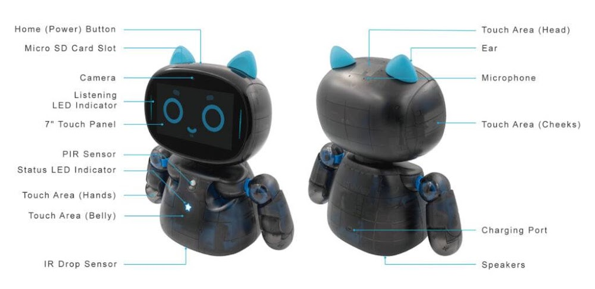

# 골든타임 응급대응 소셜 로봇 연구제안서
연구 책임자: 오염덕 & 연구원: 유익
## 1. 연구의 요약 및 핵심 주장(Executive Summary)
본 연구 과제의 핵심 가치는 의학적 "진단(Diagonosis)"이 아니라, 급성 응급 발생 시 발견-신고-초동 지시까지 발생하는 3대 치명적 지연 시간, 즉 '인식 지연(Time-to-Recognition)', '출동 지연(Time-to-Dispatch)', '초동 압박 지연(Time-to-First-Compression)'을 최소화하는 것에 있다. 이 세 구간은 심정지 및 뇌졸중 환자의 생존율을 결정짓는 골든타임 손실의 대부분을 차지하며, 물리적·의학적 처치를 직접 수행할 수 없는 '비접촉 데스크톱 소셜 로봇'이 개입하여 사회적 기여를 할 수 있는 유일하고도 가장 효과적인 오퍼레이션 구간이다.

본 연구는 로봇의 역할을 고비용의 전문 진단 기기가 아닌, **"현장 밀착형 트리아지(Triage) 보조 및 119 디스패처 연장 단말(Dispatcher-Assisted CPR On-Scene Terminal)"**로 명확히 포징한다. 이러한 접근법은 기술적 실현 가능성을 극대화할 뿐만 아니라, 의료기기 인허가 장벽을 영리하게 우회하는 전략적 기반이 된다.
## 2. 대상 사건 및 시스템 사양 (Target Events & System Specifications)
2.1 대상 사건 (Target Emergency Events)
- 급성 허탈 (Acute Collapse): 심정지가 의심되는 급작스러운 쓰러짐 및 움직임 소실.
뇌졸중 의심 징후 (Acute Stroke Indicators): 안면 및 편측 마비(Hemiplegia), 구음장애(Dysarthria), 비대칭적 낙상 패턴.
의식 소실을 동반한 중증 낙상 (Traumatic Fall with Loss of Consciousness).

2.2 하드웨어 플랫폼 전제 및 사양 (Platform Constraints)
본 연구는 고전력·고비용의 맞춤형 로봇을 배제하고, 코딩 교육용 로봇(누아로보틱스 케비로봇)의 사양을 basekube으로 전제한다.

- 센서 풋프린트: RGB 비전 카메라, 마이크 어레이(Microphone Array), PIR(인체감지) 센서, IR(적외선) 낙하 감지 센서, 정전식 터치 센서.
- 액추에이터 및 I/O: 7인치 터치 디스플레이, 다축 상지 관절 모듈(Expressive Upper Limbs), 듀얼 스피커, 상태 표시형 LED 인디케이터.
- 기능적 경계: 환자에 대한 직접적인 물리적 처치(Mechanical Intervention) 기능은 포함하지 않음.
## 3. 핵심 기술 기여 (Core TeTechnical Contributions)
계층형 캐스케이드 추론 구조 (Hierarchical Cascade Inference)
컴퓨팅 자원이 제한된 엣지(Edge) 환경을 고려하여, '저전력 상시 환경 감시(Low-power Ambient Monitoring)' 모드에서 이상 징후를 1차 필터링한 후, 이벤트 발생 시에만 '고비용 신경망 확인 추론(High-compute Verification Inference)' 라이브러리를 선택적으로 활성화하는 캐스케이드 파이프라인을 구축한다.
사건 유형별 베이지안 증거 융합 및 비대칭 비용 임계값 (Asymmetric Bayesian Evidence Fusion)
시각(비전 스켈레톤 트래킹), 청각(충격음 및 거친 숨소리 분석), 공간 센서(PIR)의 이기종 데이터를 베이지안 확률 모델로 결합한다. 특히, 응급 상황을 놓치는 미감지(False Negative)의 치명적 비용을 방지하기 위해 통계적 임계값을 비대칭적으로 설계(Asymmetric Cost Optimization)하여 오보(False Alarm)보다 미감지율을 극소화하는 데 집중한다.
환자/목격자 이중 대상 HRI 정책 (Dual-Target Human-Robot Interaction)
상지 관절의 제스처와 스크린, 스피커를 위기 상황에 맞게 이원화한다. 환자에게는 의식 확인을 위한 시·청각적 자극 및 동공 반응을 유도하고, 주변 목격자(Bystander)에게는 로봇의 팔 관절 모션을 통한 애니메이션과 디스플레이 가이드를 제공하여 '디스패처 지도형 CPR'의 이행률을 높인다.
119 상황실 연동용 구조화 사건 패킷 (Structured Emergency Packet, SEP)
오디오/비디오 원시 데이터를 그대로 송출하여 발생하는 대역폭 지연을 막고, 프라이버시를 보호하기 위해 현장에서 추출된 핵심 메타데이터(사건 발생 시각, 의심 증상 벡터, 의식 추정 점수)를 경량화된 표준 구조화 패킷으로 정제하여 119 및 의료기관 시스템에 저지연(Low-latency)으로 초동 전송한다.
## 4. 시스템 제약 조건 및 인프라 융합 돌파구 (Constraints & Architectural Breakthrough)
4.1 하드웨어적 제약 (Physical Limitations)
데스크톱 로봇의 고정된 시점은 필연적으로 시야각(FOV)의 한계와 가구 등에 의한 가림(Occlusion) 문제를 발생시킨다. 단일 로봇 단말 하나로 주거 및 건물 전체 공간을 상시 커버하는 것은 불가능하므로, 본 연구는 학술적·공학적 정직성을 바탕으로 일차적 공간 정의를 **"단일 실내 공간의 응급 공간 허브(Single-Room Emergency Hub)"**로 한정한다.

4.2 인프라 연동을 통한 공간적 확장 (Spatial Infrastructure Integration)
앞서 언급한 공간적 가림 한계를 극복하기 위해, 본 시스템은 독자적인 센싱에만 의존하지 않고 '건물 내 기설치된 CCTV 및 주변 IoT 카메라 인프라'와 실시간 공간 비전 데이터를 연동하는 고차원 아키텍처를 제안한다.

네트워크 환경 내 주변 카메라가 응급 사건(예: 거실 복도에서의 낙상 등)을 최초 포착하면, 거점 허브에 위치하던 소셜 로봇이 연동된 위치 좌표 신호를 수신하여 사고 현장(On-Scene)으로 자동 이동(Autonomous Navigation) 또는 최적 시야각을 확보할 수 있는 지점으로 재배치된다. 이를 통해 사각지대를 완전히 소거하고, 환자 바로 옆 밀착 영역에서 정의된 HRI 인터랙션 및 119 구조 유도 작업을 성공적으로 수행할 수 있는 '공간 융합형 스마트 메디컬 에이전트'를 구현한다.